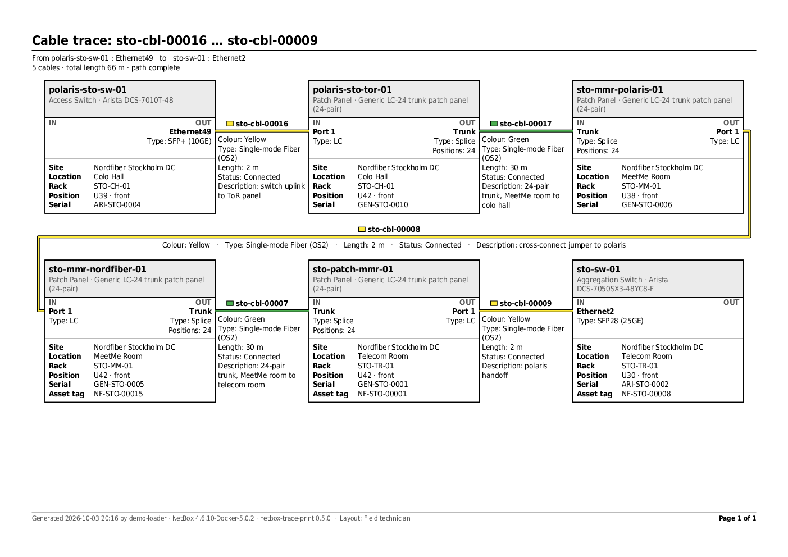

# netbox-trace-print

A NetBox plugin that turns a cable trace into a printable **PDF** for technicians
and field engineers. Each device on the path is a block, laid out in a grid that
wraps like text across the page, so a long trace reads A–B–C–D on one row and
continues E–F–G on the next.



*Example: a colocation tenant's path from its switch to Nordfiber's core switch, A4 landscape, printed with the
Field technician profile (`samples/0.5.0/field-technician-nordfiber-colo-tenant-a4-landscape.pdf`).*

**Status: early development (0.6.0).** Start from a cable, interface, front port or circuit termination
(and, with netbox-wdm / netbox-fms, a WDM circuit, fiber cable or fiber circuit), choose which facts to print
(by recipient, using print profiles), extend the trace at either end, see it as a PDF in the page and download
it, optionally limited to one site, location or rack. Colours by site/rack are next. See `docs/ROADMAP.md` and
`CHANGELOG.md`.

## Use

**Plugins → Trace Print → Print cable trace**. One page does it all: the PDF preview is on the left (empty until you
have chosen something) and the menu is on the right. Buttons for the kinds of starting point (Cable,
Interface, Front port, Circuit termination, and with netbox-wdm / netbox-fms also WDM circuit, Fiber cable and Fiber circuit) sit at the top; picking one opens a dropdown
below them on the same page. Only objects that have a cable are listed, since the others have no trace. Ports are listed
as `equipment : port` (and found by either part) so that many `Port 1` can be told apart, and a cable shows the
two ends it connects.
The buttons and dropdown stay at the top of the menu, so you can switch to another object at any time.
Choose the paper (with colour or black and white), the orientation (A4 landscape in colour by default) and the
facts in the print bar at the top of the page. A port that several paths run through offers a choice
of path. A **trunk cable** carries several pairs: the page asks which pair (and direction) to print before showing
anything, because a printout always follows one pair at a time. The PDF is shown in the page and can be downloaded. Sample output is in `samples/<version>/`.

**Scope.** A print always starts as the whole path. When the trace passes through several sites, locations or
racks, the *Scope* card (on the right, under *Extend the trace*) lists them and *Limit the print to* shows only the part of the path
in one of them, for example a technician at one data center doing fault analysis. Where the path leaves the
scope, an **edge marker** (a chevron) stands where it continues: *Leaves site X to equipment : port* with that
equipment's site and rack, and the cable that crosses the border is drawn between the marker and the last block
inside. At the start it reads *Enters site X from …*. A path that leaves the scope and comes back is printed as
separate **segments**, each on its own page and labelled *Segment 1 of 2*. The title still names the connection;
a line under it says what the scope is and how much of the path is shown, and every page repeats it. A circuit
or provider network has no site, location or rack of its own, so it is never inside a scope: it appears as the
edge marker where the path leaves. A hidden fact stays hidden on the markers too.

**The print bar.** One line at the top of the page, there from the start: the *Profile* with *Apply profile*,
*Manage profiles*, *Choose facts*, and on the right the *Paper*, *Orientation* and *Prepared for* of the printout,
with *Update* (it wraps onto two lines on a narrow screen). The settings are kept when you choose another object
with the selectors on the right. Short lists (profile, paper, orientation, path, scope) are plain
dropdowns. The object selectors have their search box inside the list: clicking one opens it with an empty
search box ready, and the chosen entry stays in the field without a cursor, so the menu does not change height.

**What to print.** Pick a *print profile* and press *Apply profile*, then *Choose facts*: the boxes tick exactly
that profile's facts, in columns across the page. Adjust them for this printout if you like and press Update. Five profiles are
installed: Full information, Field technician, Network engineer, Facility / colo operator and
Customer-safe. Names of equipment, ports and cables, the title, page numbers and the chevron markers
are always printed, and a fact you hide is hidden everywhere (also on the markers). The footer says which
layout was used ("Layout: Field technician", "(adjusted)" if you changed it), and an optional
"Prepared for" line goes under the title.

**Managing profiles.** The *Manage profiles* button (or Plugins → Trace Print → Print profiles): add, edit and delete profiles, with
the usual NetBox change log and permissions (`netbox_trace_print.view/add/change/delete_printprofile`).
Without view permission on profiles you can still tick facts by hand.

You need the stock trace permission (view cables) and view permission on the object type. Objects
you may not view appear by name only.

## Goals

1. Printable traces with the metadata a technician needs, selectable at print time
   depending on who receives the printout.
2. Colour by site, location or rack so connection points are easy to find, while
   staying fully readable in black and white.
3. Further improvements, such as bulk printing, cable end labels and rack
   elevations.

Paper size, colour or black and white, and orientation are chosen at print time (landscape by default), and all
the information always fits the chosen paper.

## Design constraints

- **No dependencies.** Installs on a vanilla NetBox with no extra packages. The PDF
  writer and layout engine use only the Python standard library; the font is bundled.
- **Generic fields only in the core.** Standard NetBox data (cables, ports, devices, racks,
  locations, sites, tenants, circuits). No custom fields. Facts from other plugins (netbox-fms,
  netbox-wdm) are optional extras, printed only when that plugin is installed (see *Other plugins*).
- **Own tables only.** Print profiles live in two tables of the plugin (`netbox_trace_print_printprofile`
  and `..._printprofilefield`). They hold no reference to any NetBox object and the migrations depend on
  nothing in NetBox. Installing runs them like any plugin (`manage.py migrate`, done by NetBox's
  upgrade script and by netbox-docker on start).
- UTF-8 text throughout.

## WDM circuits, fiber cables and fiber circuits as starting points

With **netbox-wdm** installed, *WDM circuit* lists the wavelength services. A service prints from muxponder to
muxponder, through the patch panels and trunks between them, and stops there (the client shelf beyond it and
anything past a regenerator are left out, and the printout says so). It is titled `WDM circuit: <name>`, shows
the channel and wavelength, and the muxponders show their channel, status and the service. A circuit with two
directions offers both. With **netbox-fms** installed, *Fiber cable (FMS)* lists the fiber cables and behaves
like the cable it describes, including the choice of pair for a trunk. *Fiber circuit (FMS)* lists the fiber
circuits. FMS follows a circuit's glass from its origin front port to its destination front port, and the printout
shows that stretch: from the panel where the circuit starts to the panel where it ends, through every cable and
MeetMe jumper between them, and nothing beyond (the printout says so). It is titled
`Fiber circuit: <id> · <name>`, and the header adds the strand count, wavelength and measured loss. A circuit
offers both directions, like a WDM circuit. In the pair dropdown of a trunk cable, every option starts with its pair
(`Pair 3 · …`), so it can be told apart even when the group heading is out of sight.

## A button on NetBox's own pages

The page of a cable, an interface, a front port or a circuit termination (and, with netbox-fms / netbox-wdm,
a fiber cable, fiber circuit or WDM circuit) has a **Print trace** button in its button row, next to Edit and
Delete. It opens the same object in the print page. It is shown only to users who may view cables, and for
interfaces, front ports and circuit terminations only when a cable is attached. NetBox lets a plugin add
buttons to that row but not to the Trace button inside its panels, so the new button sits beside the others.

**A column in NetBox's lists.** The lists of cables, interfaces (all interfaces, and a device's interfaces tab),
front ports (the same) and circuit terminations have an optional **Print trace** column: a printer icon on each
row that opens that object in the print page. It is not shown until you choose it: *Configure Table* above the
list, move *Print trace* to the selected columns, *Apply*. NetBox remembers the choice per user, and the icon only
appears on rows with a cable and for users who may view cables.

## Extending a trace

Under **Extend the trace** on the print page, *Show connections to add* lists the other cabled interfaces on
the equipment at the start and at the end of the trace, grouped by where each one leads, for example
`Ethernet49 → sto-sw-01 : Ethernet2 · 5 cables`. Click one and its path is added to the printout. The
equipment where two traces meet is drawn once, arriving on one port and leaving on another. You can keep
adding at either end (server – switch – ... – circuit – ... – switch – server), remove the last addition
again, and the whole chain is one printout with one title, summary, page numbering and set of chevron markers.
The choices live in the page address (`before=` and `after=`), so a printout can be reproduced from its link.

## Other plugins (optional)

If **netbox-fms** is installed, a cable's fiber-plant record is printed on it: fiber cable type, fibers and
construction, sheath, serial number, install date and installer, route marks, notes. If **netbox-wdm** is
installed, a muxponder's block says it is a WDM node, and its ports show channel and wavelength, channel
status, the wavelength service riding on it, and the role of the line port. A trunk cable also says which
**strands** the link uses (`Tube 1-F3 (blue), Tube 1-F4 (yellow)`: the tube and fiber to look for and their
colours, taken from the strands landed on the panel ports beside the cable) and which **fiber circuit** it belongs
to. These facts are choices in the
print profiles like any other. Neither plugin is needed: without them the facts and their choices are
simply absent, and a profile that lists them keeps working. If the other plugin changes in a way this
plugin does not understand, that part is skipped and logged instead of failing the printout.

## Cable colours

The plugin does not choose cable colours. A cable is drawn in the colour NetBox stores on it (the *Colour*
field of the cable): a coloured line and a swatch by its name. **Colour or black and white is the paper
choice**: *A4 (Color)* prints the cable colours, *A4 (B/W)* prints them as grey tones of the same lightness (still
told apart by shade and by the cable's name), on any paper size. The *Colour* fact only decides whether the
colour's name (*Colour: Green*) is printed. The sample dataset sets them by rule: grey copper, yellow fiber, black DAC cables, and green
24-pair trunks inside a site and blue ones between sites. Colouring blocks by site, location or rack is a
planned step (`docs/ROADMAP.md`).

## Known limits

- Interfaces bridged to another interface are not followed past the bridge.
- Where a path fans out over several objects at one step, they are shown as one block and only the
  first is described in detail (the printout says so).
- A single block taller than a whole page at 7 pt is reported instead of printed.
- Text is UTF-8, but the bundled font covers Latin, Greek and Cyrillic only.

## Development

```bash
./run-tests.sh                      # layout and PDF tests, in a throwaway NetBox container
python -m tests.demo_layout         # regenerate samples/<version>/ (run it in the container)
```

The live tests (`tests/live_smoke.py`, `live_render.py`, `live_profiles.py`, `live_wdm.py`, `live_fms.py`,
`live_scope.py`) run
inside a NetBox container against the Nordfiber sample data. `docs/TESTING.md` explains the local setup and how
to build that data; `docs/ARCHITECTURE.md` explains how the plugin is put together and how to add a fact, a
starting point or support for another plugin. Releases are listed in `CHANGELOG.md`.

## Compatibility

NetBox 4.6.x.

## Install

```bash
pip install netbox-trace-print        # or: pip install -e . from a checkout
```

Add to `PLUGINS` in NetBox's `configuration.py` (no `PLUGINS_CONFIG` needed):

```python
PLUGINS = ["netbox_trace_print"]
```

## License

Apache-2.0, the same as NetBox.

## Third-party

The PDF text uses the DejaVu Sans and DejaVu Sans Condensed fonts (regular and bold),
bundled in `netbox_trace_print/fonts/` under the Bitstream Vera / DejaVu licence
(`LICENSE-DejaVu.txt`). They cover Latin, Greek and Cyrillic; other scripts such as
CJK are not covered.
